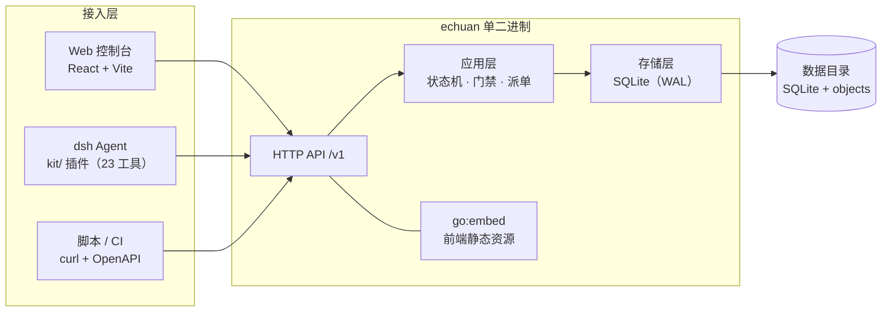

# 驿传 echuan

> 面向 AI Agent 团队的需求流转与工作项派发平台。

[](go.mod)
[](web/package.json)
[](https://www.sqlite.org/)
[](LICENSE)

驿传把「需求 → 方案 → 拆解 → 开发」拆成一条可评审、可追溯、可派发的工作项流水线：
人负责在关键节点做评审，Agent（Worker）通过 HTTP 竞争领取任务、提交产出，平台负责状态机、
租约、重试与资料版本管理。

- **单二进制**：Go 编译产物内置 Web 控制台，前端通过 `go:embed` 打包
- **零外部依赖**：SQLite + 本地对象目录，不需要独立数据库或对象存储
- **工作项即派单实体**：四类队列（需求 / 方案 / 拆解 / 开发）统一建模
- **人工门禁**：需求、方案、任务批次三处评审，决策绑定资料版本
- **Agent 友好**：仓库内 `kit/` 提供 dsh（Cordis 4）插件，23 个工具覆盖全流程

## 目录

- [它解决什么问题](#它解决什么问题)
- [核心概念](#核心概念)
- [项目状态机](#项目状态机)
- [工作项与队列](#工作项与队列)
- [Worker 模型](#worker-模型)
- [架构](#架构)
- [快速开始](#快速开始)
- [配置](#配置)
- [Agent 接入（kit）](#agent-接入kit)
- [HTTP API](#http-api)
- [开发与测试](#开发与测试)
- [部署](#部署)
- [项目结构](#项目结构)
- [文档](#文档)
- [License](#license)

## 它解决什么问题

当多个 AI Agent 共同开发一个产品时，真正难的不是「让 Agent 写代码」，而是：

- 需求、方案、拆解结果**存在哪里、以哪一版为准**
- 谁来判断需求可以进入开发、方案是否通过、任务是否验收
- 多个 Agent 如何**不重复领取**同一张任务卡
- Agent 崩溃、超时、断线后任务如何**安全重派**
- 全流程如何留下**可追溯的评审记录与产出物**

驿传用「项目状态机 + 统一工作项 + Worker 租约 + 资料版本」四件事回答上述问题。
平台本身不调用 LLM，也不执行代码；Agent 侧通过 `kit/` 接入，按队列领取并回传结果。

## 核心概念

| 概念 | 说明 |
| --- | --- |
| **产品 Product** | 一个代码仓库/产品实体，包含名称、Git 地址、License 等元信息 |
| **项目 Project** | 一次需求交付，拥有需求、方案、任务卡与评审记录，沿九状态机推进 |
| **工作项 Work Item** | 唯一派单实体，按 `kind` 进入四条队列之一；不再有独立的 task 概念 |
| **资料 Material** | 版本化的文档/报告，按内容寻址存储，支持版本链与下载 |
| **评审门 Gate** | 人工审批点，决策（approve/reject）落在 `gate_decisions`，绑定被审资料版本 |
| **Worker** | 一个 Agent 进程；注册时声明消费哪些 `kind`，通过心跳领取任务 |
| **租约 Lease** | 工作项被领取后的独占期；到期未续租自动回到队列，超过最大次数置为 failed |

## 项目状态机

```
0 需求草稿 ──submit──▶ 1 需求评审 ──approve──▶ 2 方案草稿
                                              │
                                              ▼
                          3 方案评审 ◀──submit──┘
                              │ approve
                              ▼
4 任务拆分 ──首张卡入队──▶ 5 任务清单评审 ──批次通过──▶ 6 待完成
                                                          │ 全部结算
                                                          ▼
                                                      7 已完成

任意非终态 ──cancel──▶ 8 已取消
```

- 状态值持久化在 `projects.status`（0–8），迁移规则集中在 `internal/domain/project.go`
- 需求/方案/任务批次评审均由人触发；进入 0/2/4 时自动创建下一阶段工作项
- 7（已完成）与 8（已取消）是终态

## 工作项与队列

| kind | 队列 | Agent 产出 | 资料类型 |
| --- | --- | --- | --- |
| `requirement` | 需求 | 需求文档 | kind=1 需求 |
| `design` | 方案 | 技术方案 | kind=2 方案 |
| `breakdown` | 拆解 | 开发计划，并派生 `dev` 卡 | kind=4 计划 |
| `dev` | 开发 | 代码变更说明 / 测试报告 | kind=3 报告 |

工作项状态：

```
blocked → queued → leased → submitted → accepted
                    │           │
                    └── 超时/失败 ─┴──▶ failed（超过 max_attempts）
任意非终态 ──▶ cancelled
```

- `blocked`：依赖未满足，暂不可领取
- `queued`：可领取；依赖按 `depends_on` 自动解锁
- `leased`：已被某个 Worker 持有，租约期内独占
- `submitted`：产出已回传，等待人工验收
- `accepted` / `failed` / `cancelled`：终态

## Worker 模型

- Worker 注册时声明 `kinds`（可多选），平台按队列竞争派发
- **一个 Worker 对应一个 Agent，单租约串行**：同一时刻只持有一张卡
- 心跳同时承担「保活」与「领取任务」两个职责；无任务时走长轮询（默认 25s）
- 默认参数：租约 90s、心跳间隔 15s、Worker 离线判定 45s、单卡最多尝试 3 次
- 超时未续租的工作项自动回到 `queued`，尝试次数耗尽后进入 `failed`

运维细节见 [`docs/worker-ops.md`](docs/worker-ops.md)。

## 架构



- 前端构建产物同步到 `internal/web/dist` 后由 `go:embed` 打进二进制
- 资料按内容寻址存放在数据目录，数据库只保存元信息与版本指针
- 列表/详情接口不内联长正文，正文统一走 `GET /v1/materials?id=`，避免轮询搬运大文档

## 快速开始

### Docker（推荐）

```bash
cp .env.example .env      # 可选：自定义端口 / 数据目录 / 构建镜像源
make docker-build         # 多阶段构建：前端 + Go + 最小运行镜像
make docker-up            # docker compose up -d
curl -fsS 127.0.0.1:8721/readyz
```

打开 <http://127.0.0.1:8721> 即可使用 Web 控制台。

- 数据默认落在 `~/echuan-v2-data`，可用 `.env` 的 `ECHUAN_DATA_DIR` 覆盖
- 容器以 UID/GID `10001` 非 root 运行，宿主仅监听 `127.0.0.1:8721`（映射容器内 8720）
- compose 项目/容器/镜像默认名均为 `echuan-v2`，可与 v1 并行部署

### 本地运行

```bash
make web                  # 构建前端并同步到 internal/web/dist
make build                # 生成 ./echuan
./echuan -config configs/echuan.toml
```

默认监听 `127.0.0.1:8720`，数据目录 `~/.echuan`；样例配置使用 `8721` / `~/echuan-v2-data`。
也可以完全不用配置文件，通过 `ECHUAN_*` 环境变量覆盖。

### 健康检查

```bash
curl -fsS 127.0.0.1:8721/healthz   # 存活
curl -fsS 127.0.0.1:8721/readyz    # 就绪（含数据库）
```

## 配置

优先级：**环境变量（`ECHUAN_*`） > TOML 文件 > 内置默认值**。TOML 为扁平 `key = value`，
支持 `#` 注释，样例见 [`configs/echuan.toml`](configs/echuan.toml)。

常用配置：

| 键 | 环境变量 | 默认值 | 说明 |
| --- | --- | --- | --- |
| `listen` | `ECHUAN_LISTEN` | `127.0.0.1:8720` | HTTP 监听地址；容器内为 `0.0.0.0:8720` |
| `data_dir` | `ECHUAN_DATA_DIR` | `~/.echuan` | SQLite 与物料对象根目录 |
| `lease_ttl` | `ECHUAN_LEASE_TTL` | `90s` | 工作项租约有效期 |
| `max_attempts` | `ECHUAN_MAX_ATTEMPTS` | `3` | 单卡最大尝试次数 |
| `worker_ttl` | `ECHUAN_WORKER_TTL` | `45s` | 心跳超时判定离线的窗口 |
| `heartbeat_interval` | `ECHUAN_HEARTBEAT_INTERVAL` | `15s` | 建议 Worker 使用的心跳间隔 |
| `poll_timeout` | `ECHUAN_POLL_TIMEOUT` | `25s` | `claim` 长轮询超时 |
| `material_max_bytes` | `ECHUAN_MATERIAL_MAX_BYTES` | `20971520` | 单个物料最大字节数（20 MiB） |

完整配置项、校验规则与调参建议见 [`docs/deploy.md`](docs/deploy.md)。

## Agent 接入（kit）

`kit/` 是同仓的 dsh（Cordis 4）插件，把平台 HTTP 契约封装成 23 个工具，
覆盖产品/项目创建、需求与方案写入、计划提交、任务领取、报告回传、资料下载等完整生命周期。

```bash
cd kit
pnpm install && pnpm build

# 安装到 dsh profile（--profile 必须在 add 之前）
dsh profile init <profile>          # 已存在可跳过
dsh plugin add --profile <profile> ./kit
```

最小配置：

```yaml
echuan:
  base_url: http://127.0.0.1:8721
  worker_id: w_demo_01
  kinds: [dev]          # 该 Agent 消费的队列
```

安装、按 Agent 裁剪工具（`exclude`）、排障与验收脚本见 [`kit/README.md`](kit/README.md)。

## HTTP API

- 契约文件：[`api/openapi.yaml`](api/openapi.yaml)（OpenAPI 3.0.3，36 个 operation）
- 统一前缀 `/v1`；所有响应带 `X-Request-Id`
- 错误体统一为 `Error`，`details` 永远是数组（无明细时为 `[]`）
- 资源列表与详情共用路径，通过 `?id=` 选择详情

核心端点：

| 方法 | 路径 | 说明 |
| --- | --- | --- |
| `GET` | `/healthz` / `/readyz` | 存活 / 就绪 |
| `POST` | `/v1/products` | 创建产品 |
| `POST` | `/v1/projects` | 创建项目 |
| `POST` | `/v1/projects/requirement?id=` | 写入需求 |
| `POST` | `/v1/projects/submit?id=` | 提交需求评审 |
| `POST` | `/v1/projects/decide?id=` | 审批（approve/reject） |
| `POST` | `/v1/specs` | 创建技术方案 |
| `POST` | `/v1/projects/plans?id=` | 提交任务拆分计划 |
| `POST` | `/v1/workers/heartbeat` | Worker 注册（首次不带 `worker_id`）/ 心跳 / 领取任务 |
| `POST` | `/v1/work-items/report` | 回传任务报告 |
| `GET` | `/v1/inbox` | 待评审收件箱 |
| `GET` | `/v1/materials?id=` | 下载资料正文 |

首次上线的完整 curl 流程（建产品 → 需求 → 方案 → 拆解 → 领取 → 报告 → 验收）
见 [`docs/deploy.md`](docs/deploy.md) 第 9 节。

## 开发与测试

```bash
make build      # 编译 ./echuan
make test       # go test ./... -race
make lint       # go vet（存在 staticcheck 时一并执行）
make contract   # 接口契约校验（36 个 operation + 校验器自测）
make web        # 构建前端并同步到 internal/web/dist
make e2e        # Worker 全链路端到端验收（临时目录 + 随机端口，约 90s）
```

> 发布二进制前先 `make web`：`make build` 刻意不依赖前端构建（避免纯后端构建强制安装 pnpm），
> 前端由 `go:embed` 打进二进制，不重新构建就会带上一次提交的旧产物。

## 部署

```bash
make docker-build     # 构建镜像
make docker-up        # 启动
make docker-logs      # 查看日志
make docker-down      # 停止（数据保留）
```

- 备份：`scripts/backup.sh`
- 恢复：`scripts/restore.sh --latest`
- 升级、回滚、排障与镜像基线：见 [`docs/deploy.md`](docs/deploy.md)

## 项目结构

```
.
├── cmd/echuan/          # 进程入口与配置加载
├── internal/
│   ├── api/             # HTTP 路由、请求/响应
│   ├── app/             # 应用服务：状态机、门禁、派单、拆解
│   ├── contract/        # OpenAPI 契约测试
│   ├── domain/          # 项目状态机与领域常量
│   ├── inbox/           # 待评审收件箱
│   ├── material/        # 物料存储与内容寻址
│   ├── platform/        # 平台基础设施
│   ├── store/           # SQLite 持久化
│   └── web/             # go:embed 的前端产物
├── web/                 # React + Vite 前端源码
├── kit/                 # dsh Agent 插件（23 个工具）
├── api/openapi.yaml     # HTTP 接口契约
├── docs/                # 部署、项目规格、Worker 运维
├── migrations/          # SQLite schema 迁移
└── scripts/             # 构建、备份、E2E 脚本
```

## 文档

| 文档 | 内容 |
| --- | --- |
| [`docs/deploy.md`](docs/deploy.md) | 首次部署、配置、备份恢复、升级回滚、排障、curl 上线手册 |
| [`docs/project-specs.md`](docs/project-specs.md) | 多技术方案、资料包、详情与正文分离 |
| [`docs/worker-ops.md`](docs/worker-ops.md) | Worker 注册、心跳、错误码、清理与验收 |
| [`kit/README.md`](kit/README.md) | dsh 插件安装、配置、工具清单与故障对照 |
| [`api/openapi.yaml`](api/openapi.yaml) | 完整 HTTP 契约 |

## 状态

项目处于早期阶段（v0.1）：核心状态机、四类工作项队列、Worker 租约、资料版本与 Web 控制台
均已落地；接口契约以 `api/openapi.yaml` 为准。

## License

[Apache-2.0](LICENSE)
